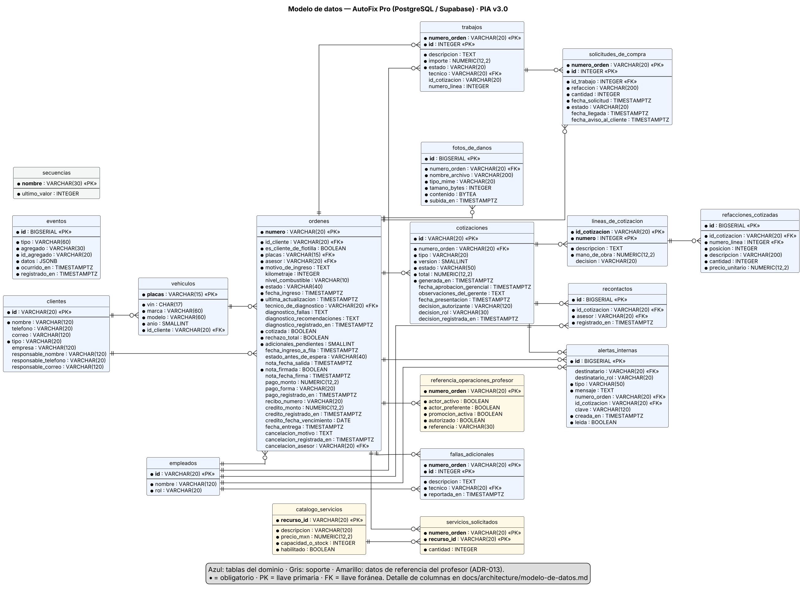

# Modelo de datos — AutoFix Pro (PIA v3.0)

Esquema oficial de la base de datos (PostgreSQL 16 en Docker y en **Supabase**, ADR-009). Lo genera `scripts/db/esquema.py`, que también produce `database/01_esquema.sql` y el diagrama `diagramas/modelo-de-datos.png`.

**Reglas del mapeo:** cada Aggregate tiene su tabla raíz (`ordenes`, `cotizaciones`, `clientes`, `vehiculos`, `empleados`); las entidades internas tienen llave compuesta con el folio de su raíz; los Value Objects se guardan como columnas. Importes en `NUMERIC(12,2)` (pesos con centavos, se leen como `Decimal`) y fechas en `TIMESTAMPTZ` (UTC). Los nombres de estado son los del Glosario y la base los valida con `CHECK`. Las reglas de negocio **no** se programan en la base: viven en el dominio; la base solo protege la integridad (llaves, tipos y valores permitidos).

**Implementación:** `src/infrastructure/base_de_datos/tablas.py` (SQLAlchemy) debe tener exactamente estas tablas y columnas; una prueba de integración con PostgreSQL lo verifica. En las pruebas sin Docker se usa SQLite con `metadata.create_all()`.

## Tablas (18)

### Dominio

#### `empleados`

Empleados del taller (Aggregate Empleado). Los tokens de acceso NO se guardan aquí: vienen de variables de entorno (ADR-012).

| Columna | Tipo | Nulo | Descripción |
|---|---|---|---|
| `id` (PK) | VARCHAR(20) | no | Identificador del empleado (EMP-001…) |
| `nombre` | VARCHAR(120) | no | Nombre completo |
| `rol` | VARCHAR(20) | no | RolDeEmpleado |

CHECK `rol IN ('Asesor', 'Técnico', 'Gerente', 'Compras', 'Caja')`

#### `clientes`

Clientes particulares o de flotilla (Aggregate Cliente).

| Columna | Tipo | Nulo | Descripción |
|---|---|---|---|
| `id` (PK) | VARCHAR(20) | no | Identificador (AUT-C001 en los datos del profesor) |
| `nombre` | VARCHAR(120) | no | Nombre del cliente o razón social |
| `telefono` | VARCHAR(20) | sí | Teléfono de contacto |
| `correo` | VARCHAR(120) | sí | Correo de contacto |
| `tipo` | VARCHAR(20) | no | TipoCliente: Particular o Flotilla · por defecto 'Particular' |
| `empresa` | VARCHAR(120) | sí | Empresa (solo flotilla) |
| `responsable_nombre` | VARCHAR(120) | sí | Responsable de Flotilla (solo flotilla) |
| `responsable_telefono` | VARCHAR(20) | sí | Teléfono del Responsable de Flotilla |
| `responsable_correo` | VARCHAR(120) | sí | Correo del Responsable de Flotilla |

CHECK `tipo IN ('Particular', 'Flotilla')` · CHECK `tipo = 'Particular' OR (empresa IS NOT NULL AND responsable_nombre IS NOT NULL)`

#### `vehiculos`

Vehículos (Aggregate Vehículo). Las placas se guardan normalizadas: mayúsculas, sin espacios ni guiones.

| Columna | Tipo | Nulo | Descripción |
|---|---|---|---|
| `placas` (PK) | VARCHAR(15) | no | Placas normalizadas (Value Object Placas) |
| `vin` | CHAR(17) | no | Número de serie VIN (17 caracteres, sin I, O ni Q) |
| `marca` | VARCHAR(60) | no | Marca |
| `modelo` | VARCHAR(60) | no | Modelo |
| `anio` | SMALLINT | no | Año del modelo |
| `id_cliente` | VARCHAR(20) | no | Propietario |

FK (id_cliente) → `clientes` (id) · UNIQUE (vin) · CHECK `placas ~ '^[A-Z0-9]+$'` · CHECK `vin ~ '^[A-HJ-NPR-Z0-9]{17}$'` · CHECK `anio BETWEEN 1900 AND 2100`

#### `ordenes`

Órdenes de Servicio (Aggregate Orden de Servicio). Los Value Objects (recepción, diagnóstico, nota, pago, crédito, cancelación) se guardan como columnas.

| Columna | Tipo | Nulo | Descripción |
|---|---|---|---|
| `numero` (PK) | VARCHAR(20) | no | Folio (NumeroOrden): OS-0001… o AUT-O001 en los datos del profesor |
| `id_cliente` | VARCHAR(20) | no | Cliente |
| `es_cliente_de_flotilla` | BOOLEAN | no | Copia del tipo de cliente al registrar la orden · por defecto FALSE |
| `placas` | VARCHAR(15) | no | Vehículo |
| `asesor` | VARCHAR(20) | no | Asesor que registró la orden (recibe sus alertas) |
| `motivo_de_ingreso` | TEXT | no | Motivo de ingreso |
| `kilometraje` | INTEGER | sí | Estado de recepción: kilometraje (sin dato en las órdenes importadas) |
| `nivel_combustible` | VARCHAR(10) | sí | Estado de recepción: nivel de combustible |
| `estado` | VARCHAR(40) | no | EstadoOrden (13 estados del Glosario) · por defecto 'Recibida' |
| `fecha_ingreso` | TIMESTAMPTZ | no | Fecha y hora de ingreso |
| `ultima_actualizacion` | TIMESTAMPTZ | no | Última actualización (consulta del cliente, CA-037) |
| `tecnico_de_diagnostico` | VARCHAR(20) | sí | Técnico asignado al diagnóstico (CA-035) |
| `diagnostico_fallas` | TEXT | sí | Diagnóstico: fallas encontradas (CA-032) |
| `diagnostico_recomendaciones` | TEXT | sí | Diagnóstico: trabajos y refacciones recomendados |
| `diagnostico_registrado_en` | TIMESTAMPTZ | sí | Diagnóstico: fecha y hora |
| `cotizada` | BOOLEAN | no | Ya tiene cotización (el diagnóstico ya no cambia, CA-033) · por defecto FALSE |
| `rechazo_total` | BOOLEAN | no | El cliente rechazó toda la cotización (CA-012) · por defecto FALSE |
| `adicionales_pendientes` | SMALLINT | no | Cotizaciones adicionales sin decisión (CA-015, CA-018) · por defecto 0 |
| `fecha_ingreso_a_fila` | TIMESTAMPTZ | sí | Lugar en la fila de trabajo (CA-013, CA-025) |
| `estado_antes_de_espera` | VARCHAR(40) | sí | Estado al que regresa al llegar las refacciones (CA-022) |
| `nota_fecha_salida` | TIMESTAMPTZ | sí | Nota de Responsabilidad: salida del vehículo (CA-024) |
| `nota_firmada` | BOOLEAN | no | Nota de Responsabilidad firmada · por defecto FALSE |
| `nota_fecha_firma` | TIMESTAMPTZ | sí | Fecha de la firma |
| `pago_monto` | NUMERIC(12,2) | sí | Pago de contado (CA-026) |
| `pago_forma` | VARCHAR(20) | sí | Forma de pago |
| `pago_registrado_en` | TIMESTAMPTZ | sí | Fecha del pago (ingresos del día, CA-031) |
| `recibo_numero` | VARCHAR(20) | sí | Número del recibo interno (CA-027) |
| `credito_monto` | NUMERIC(12,2) | sí | Cargo a crédito de flotilla (CA-039) |
| `credito_registrado_en` | TIMESTAMPTZ | sí | Fecha del cargo |
| `credito_fecha_vencimiento` | DATE | sí | Vencimiento = entrega + 15 días naturales (CA-041) |
| `fecha_entrega` | TIMESTAMPTZ | sí | Entrega del vehículo (CA-041, CA-043) |
| `cancelacion_motivo` | TEXT | sí | Motivo de la cancelación (CA-044) |
| `cancelacion_registrada_en` | TIMESTAMPTZ | sí | Fecha de la cancelación |
| `cancelacion_asesor` | VARCHAR(20) | sí | Asesor que canceló |

FK (id_cliente) → `clientes` (id) · FK (placas) → `vehiculos` (placas) · FK (asesor) → `empleados` (id) · FK (tecnico_de_diagnostico) → `empleados` (id) · FK (cancelacion_asesor) → `empleados` (id) · UNIQUE (recibo_numero) · CHECK `estado IN ('Recibida', 'En Diagnóstico', 'Cotizada', 'Autorizada', 'En Reparación', 'En Espera de Refacción', 'Pausada por Retiro de Vehículo', 'Lista para Entrega', 'Pagada', 'Por Cobrar (Crédito)', 'Cerrada', 'Cerrada sin Reparación', 'Cancelada')` · CHECK `estado_antes_de_espera IS NULL OR estado_antes_de_espera IN ('Autorizada', 'En Reparación')` · CHECK `kilometraje IS NULL OR kilometraje >= 0` · CHECK `nivel_combustible IS NULL OR nivel_combustible IN ('Reserva', '1/4', '1/2', '3/4', 'Lleno')` · CHECK `adicionales_pendientes >= 0` · CHECK `pago_forma IS NULL OR pago_forma IN ('Efectivo', 'Tarjeta', 'Transferencia')` · CHECK `pago_monto IS NULL OR pago_monto >= 0` · CHECK `credito_monto IS NULL OR credito_monto >= 0` · CHECK `NOT (pago_monto IS NOT NULL AND credito_monto IS NOT NULL)` · CHECK `estado <> 'Cancelada' OR cancelacion_motivo IS NOT NULL`

#### `trabajos`

Trabajos de la orden (entidad interna). Se crean al registrar la decisión del cliente.

| Columna | Tipo | Nulo | Descripción |
|---|---|---|---|
| `numero_orden` (PK) | VARCHAR(20) | no | Orden |
| `id` (PK) | INTEGER | no | Número del trabajo dentro de la orden (1, 2, …) |
| `descripcion` | TEXT | no | Descripción |
| `importe` | NUMERIC(12,2) | no | Importe (mano de obra + refacciones de la línea) |
| `estado` | VARCHAR(20) | no | EstadoTrabajo · por defecto 'Pendiente' |
| `tecnico` | VARCHAR(20) | sí | Técnico asignado (CA-036) |
| `id_cotizacion` | VARCHAR(20) | sí | Cotización de donde salió |
| `numero_linea` | INTEGER | sí | Línea de la cotización de donde salió |

FK (numero_orden) → `ordenes` (numero) · FK (tecnico) → `empleados` (id) · CHECK `estado IN ('Pendiente', 'En Progreso', 'Completado', 'No Autorizado')` · CHECK `importe >= 0` · CHECK `id >= 1`

#### `solicitudes_de_compra`

Solicitudes de compra de refacciones (entidad interna de la orden).

| Columna | Tipo | Nulo | Descripción |
|---|---|---|---|
| `numero_orden` (PK) | VARCHAR(20) | no | Orden |
| `id` (PK) | INTEGER | no | Número de la solicitud dentro de la orden |
| `id_trabajo` | INTEGER | no | Trabajo autorizado al que pertenece (CA-020) |
| `refaccion` | VARCHAR(200) | no | Descripción de la refacción |
| `cantidad` | INTEGER | no | Cantidad |
| `fecha_solicitud` | TIMESTAMPTZ | no | Desde aquí corren los 3 días hábiles (CA-023) |
| `estado` | VARCHAR(20) | no | EstadoSolicitud · por defecto 'Solicitada' |
| `fecha_llegada` | TIMESTAMPTZ | sí | Llegada de la refacción (CA-022) |
| `fecha_aviso_al_cliente` | TIMESTAMPTZ | sí | Aviso de retraso al cliente (CA-023) |

FK (numero_orden) → `ordenes` (numero) · FK (numero_orden, id_trabajo) → `trabajos` (numero_orden, id) · CHECK `estado IN ('Solicitada', 'Disponible')` · CHECK `cantidad > 0`

#### `fallas_adicionales`

Fallas adicionales reportadas durante la reparación (CA-034).

| Columna | Tipo | Nulo | Descripción |
|---|---|---|---|
| `numero_orden` (PK) | VARCHAR(20) | no | Orden |
| `id` (PK) | INTEGER | no | Número de la falla dentro de la orden |
| `descripcion` | TEXT | no | Descripción de la falla |
| `tecnico` | VARCHAR(20) | no | Técnico que la reportó |
| `reportada_en` | TIMESTAMPTZ | no | Fecha y hora |

FK (numero_orden) → `ordenes` (numero) · FK (tecnico) → `empleados` (id)

#### `fotos_de_danos`

Fotos de daños visibles al recibir el vehículo (CA-002, ADR-014). Máximo 5 MB, JPEG o PNG.

| Columna | Tipo | Nulo | Descripción |
|---|---|---|---|
| `id` (PK) | BIGSERIAL | no | Identificador |
| `numero_orden` | VARCHAR(20) | no | Orden |
| `nombre_archivo` | VARCHAR(200) | no | Nombre original |
| `tipo_mime` | VARCHAR(20) | no | image/jpeg o image/png |
| `tamano_bytes` | INTEGER | no | Tamaño |
| `contenido` | BYTEA | no | Bytes de la imagen |
| `subida_en` | TIMESTAMPTZ | no | Fecha · por defecto NOW() |

FK (numero_orden) → `ordenes` (numero) · CHECK `tipo_mime IN ('image/jpeg', 'image/png')` · CHECK `tamano_bytes BETWEEN 1 AND 5242880`

#### `cotizaciones`

Cotizaciones (Aggregate Cotización). La inicial es v.1; las adicionales v.2 en adelante.

| Columna | Tipo | Nulo | Descripción |
|---|---|---|---|
| `id` (PK) | VARCHAR(20) | no | Identificador (COT-0001…) |
| `numero_orden` | VARCHAR(20) | no | Orden |
| `tipo` | VARCHAR(20) | no | TipoCotizacion: Inicial o Adicional |
| `version` | SMALLINT | no | VersionCotizacion |
| `estado` | VARCHAR(50) | no | EstadoCotizacion (6 estados) |
| `total` | NUMERIC(12,2) | no | Suma de las líneas (dato derivado para las consultas) |
| `generada_en` | TIMESTAMPTZ | no | Fecha de generación |
| `fecha_aprobacion_gerencial` | TIMESTAMPTZ | sí | Aprobación del Gerente (CA-008) |
| `observaciones_del_gerente` | TEXT | sí | Observaciones del rechazo gerencial (CA-009) |
| `fecha_presentacion` | TIMESTAMPTZ | sí | Presentación al cliente (inicia las 48 h, CA-006) |
| `decision_autorizante` | VARCHAR(120) | sí | Nombre de quien decidió (CA-010) |
| `decision_rol` | VARCHAR(30) | sí | Cliente o Responsable de Flotilla (CA-029) |
| `decision_registrada_en` | TIMESTAMPTZ | sí | Fecha y hora de la decisión |

FK (numero_orden) → `ordenes` (numero) · UNIQUE (numero_orden, version) · CHECK `tipo IN ('Inicial', 'Adicional')` · CHECK `(tipo = 'Inicial' AND version = 1) OR (tipo = 'Adicional' AND version >= 2)` · CHECK `estado IN ('Pendiente de Aprobación Gerencial', 'Requiere Ajuste', 'Pendiente de Autorización del Cliente', 'Autorizada', 'Autorizada Parcialmente', 'Rechazada')` · CHECK `total >= 0` · CHECK `decision_rol IS NULL OR decision_rol IN ('Cliente', 'Responsable de Flotilla')`

#### `lineas_de_cotizacion`

Líneas de la cotización (entidad interna): cada trabajo propuesto con su mano de obra.

| Columna | Tipo | Nulo | Descripción |
|---|---|---|---|
| `id_cotizacion` (PK) | VARCHAR(20) | no | Cotización |
| `numero` (PK) | INTEGER | no | Número de la línea (1, 2, …) |
| `descripcion` | TEXT | no | Trabajo propuesto |
| `mano_de_obra` | NUMERIC(12,2) | no | Importe de mano de obra |
| `decision` | VARCHAR(20) | sí | Autorizada o No Autorizado (CA-010) |

FK (id_cotizacion) → `cotizaciones` (id) · CHECK `numero >= 1` · CHECK `mano_de_obra >= 0` · CHECK `decision IS NULL OR decision IN ('Autorizada', 'No Autorizado')`

#### `refacciones_cotizadas`

Refacciones de cada línea de cotización (Value Object RefaccionCotizada).

| Columna | Tipo | Nulo | Descripción |
|---|---|---|---|
| `id` (PK) | BIGSERIAL | no | Identificador |
| `id_cotizacion` | VARCHAR(20) | no | Cotización |
| `numero_linea` | INTEGER | no | Línea |
| `posicion` | INTEGER | no | Orden dentro de la línea |
| `descripcion` | VARCHAR(200) | no | Refacción |
| `cantidad` | INTEGER | no | Cantidad |
| `precio_unitario` | NUMERIC(12,2) | no | Precio unitario |

FK (id_cotizacion, numero_linea) → `lineas_de_cotizacion` (id_cotizacion, numero) · CHECK `cantidad > 0` · CHECK `precio_unitario >= 0`

#### `recontactos`

Recontactos al cliente por cotizaciones sin respuesta (CA-040).

| Columna | Tipo | Nulo | Descripción |
|---|---|---|---|
| `id` (PK) | BIGSERIAL | no | Identificador |
| `id_cotizacion` | VARCHAR(20) | no | Cotización |
| `asesor` | VARCHAR(20) | no | Asesor que recontactó |
| `registrado_en` | TIMESTAMPTZ | no | Fecha y hora (el plazo de 48 h vuelve a contar) |

FK (id_cotizacion) → `cotizaciones` (id) · FK (asesor) → `empleados` (id)

#### `alertas_internas`

Alertas internas del panel de cada empleado (no son correos ni SMS).

| Columna | Tipo | Nulo | Descripción |
|---|---|---|---|
| `id` (PK) | BIGSERIAL | no | Identificador |
| `destinatario` | VARCHAR(20) | sí | Empleado destinatario (o NULL si va a todo un rol) |
| `destinatario_rol` | VARCHAR(20) | sí | Rol destinatario (p. ej. todos los Gerentes) |
| `tipo` | VARCHAR(50) | no | Tipo de alerta (AprobacionGerencialRequerida, RefaccionRetrasada, …) |
| `mensaje` | TEXT | no | Texto para el usuario |
| `numero_orden` | VARCHAR(20) | sí | Orden relacionada |
| `id_cotizacion` | VARCHAR(20) | sí | Cotización relacionada |
| `clave` | VARCHAR(120) | sí | Evita alertas duplicadas en la revisión de plazos (ADR-015) |
| `creada_en` | TIMESTAMPTZ | no | Fecha · por defecto NOW() |
| `leida` | BOOLEAN | no | Si ya se leyó · por defecto FALSE |

FK (destinatario) → `empleados` (id) · FK (numero_orden) → `ordenes` (numero) · FK (id_cotizacion) → `cotizaciones` (id) · UNIQUE (clave) · CHECK `destinatario IS NOT NULL OR destinatario_rol IS NOT NULL` · CHECK `destinatario_rol IS NULL OR destinatario_rol IN ('Asesor', 'Técnico', 'Gerente', 'Compras', 'Caja')`

#### `eventos`

Bitácora de Domain Events (ADR-016): evidencia de transiciones y pruebas.

| Columna | Tipo | Nulo | Descripción |
|---|---|---|---|
| `id` (PK) | BIGSERIAL | no | Identificador |
| `tipo` | VARCHAR(60) | no | Nombre del evento (OrdenCancelada, CotizacionAutorizada, …) |
| `agregado` | VARCHAR(30) | no | Orden o Cotizacion |
| `id_agregado` | VARCHAR(20) | no | Folio o id de la cotización |
| `datos` | JSONB | no | Datos del evento · por defecto '{}'::jsonb |
| `ocurrido_en` | TIMESTAMPTZ | no | Cuándo ocurrió |
| `registrado_en` | TIMESTAMPTZ | no | Cuándo se guardó · por defecto NOW() |

### Soporte

#### `secuencias`

Folios consecutivos (OS-0001, COT-0001, REC-0001, CLI-0001); se revierten con la transacción.

| Columna | Tipo | Nulo | Descripción |
|---|---|---|---|
| `nombre` (PK) | VARCHAR(30) | no | orden, cotizacion, recibo, cliente |
| `ultimo_valor` | INTEGER | no | Último número usado · por defecto 0 |

CHECK `ultimo_valor >= 0`

### Datos del profesor

#### `catalogo_servicios`

Catálogo de referencia del profesor (catalogo.csv). No es parte del dominio: sirve para armar cotizaciones de demostración y para rechazar las órdenes con servicios inhabilitados con el puerto `CatalogoDeServicios` (ADR-013, H-PIA-19).

| Columna | Tipo | Nulo | Descripción |
|---|---|---|---|
| `recurso_id` (PK) | VARCHAR(20) | no | AUT-P001… |
| `descripcion` | VARCHAR(120) | no | Servicio |
| `precio_mxn` | NUMERIC(12,2) | no | Precio unitario |
| `capacidad_o_stock` | INTEGER | no | Dato del profesor sin uso en AutoFix (D-03) |
| `habilitado` | BOOLEAN | no | Un servicio inhabilitado no se puede cotizar (D-05) |

CHECK `precio_mxn >= 0` · CHECK `capacidad_o_stock >= 0`

#### `servicios_solicitados`

Detalle de referencia de cada operación del profesor (detalle_operaciones.csv).

| Columna | Tipo | Nulo | Descripción |
|---|---|---|---|
| `numero_orden` (PK) | VARCHAR(20) | no | Orden (operacion_id) |
| `recurso_id` (PK) | VARCHAR(20) | no | Servicio del catálogo |
| `cantidad` | INTEGER | no | Cantidad |

FK (numero_orden) → `ordenes` (numero) · FK (recurso_id) → `catalogo_servicios` (recurso_id) · CHECK `cantidad > 0`

#### `referencia_operaciones_profesor`

Columnas del profesor sin equivalente en el BRD, guardadas solo como referencia para los oráculos (D-01, D-02).

| Columna | Tipo | Nulo | Descripción |
|---|---|---|---|
| `numero_orden` (PK) | VARCHAR(20) | no | Orden (operacion_id) |
| `actor_activo` | BOOLEAN | no | actores.activo (D-01: AutoFix no lo usa) |
| `actor_preferente` | BOOLEAN | no | actores.es_preferente (D-02) |
| `promocion_activa` | BOOLEAN | no | operaciones.promocion_activa (D-02) |
| `autorizado` | BOOLEAN | no | operaciones.autorizado: 1 = autoriza todo; 0 = rechazo total |
| `referencia` | VARCHAR(30) | no | operaciones.referencia |

FK (numero_orden) → `ordenes` (numero)

## Scripts

| Archivo | Qué hace |
|---|---|
| `database/01_esquema.sql` | Borra y crea todas las tablas, restricciones, índices, comentarios y activa RLS (protección de la Data API de Supabase). |
| `database/02_datos_iniciales.sql` | Carga los 6 empleados de demostración y los datos del profesor en su estado inicial (40 clientes, 60 vehículos, 60 órdenes «Recibida», 20 servicios, 117 líneas de detalle). Lo genera `scripts/db/generar_datos_iniciales.py`. |
| `database/03_verificacion.sql` | Consultas para comprobar que todo se cargó (conteos esperados). |
